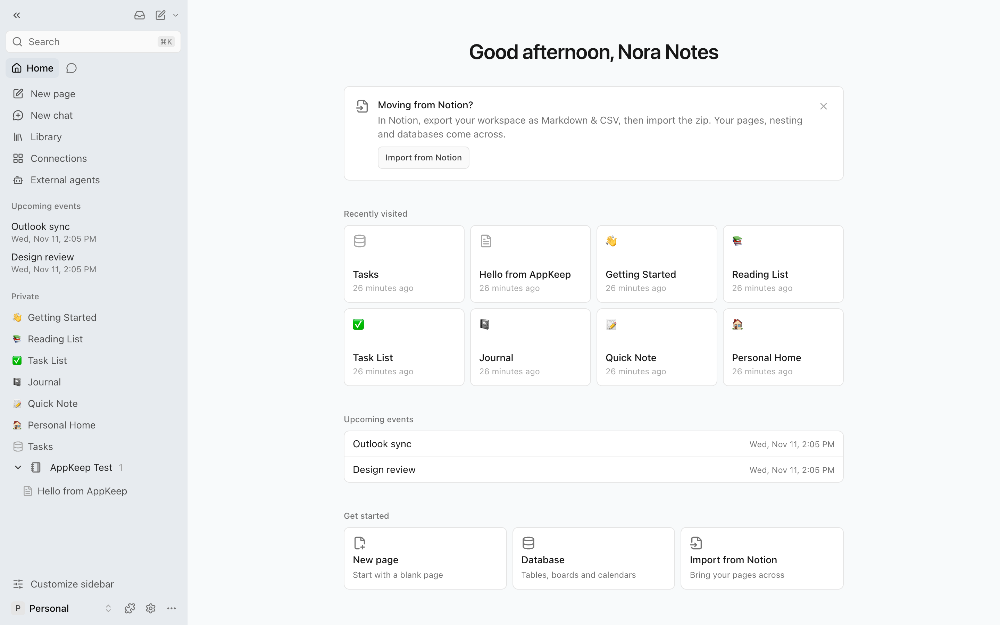
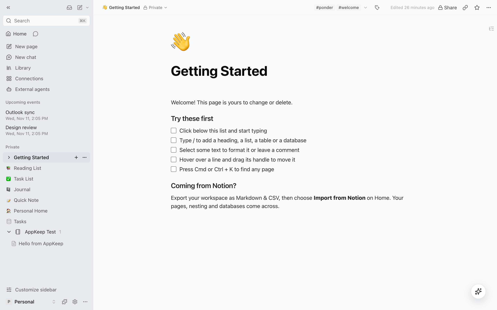
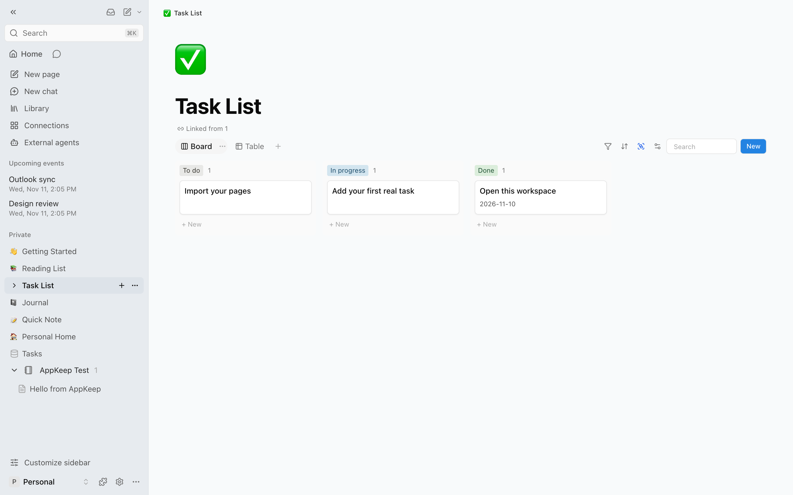

<div align="center">
  <h1>
     Ponder
  </h1>
  <p><b>A Notion-style workspace for notes, pages, databases and teams.</b></p>
  <p>
    <a href="https://appkeep.io/apps/ponder">Get Ponder on AppKeep</a>
  </p>
  <picture>
    <source media="(prefers-color-scheme: dark)" srcset="assets/readme/ponder-home-dark.png" />
    
  </picture>
</div>

Ponder is a workspace for writing and organising your work. It has pages inside pages, databases with table and board views, comments, and team workspaces where people can edit the same page at once. If you are coming from Notion, you can import your exported workspace and keep its nesting and databases.

Ponder is a modified version of [EdgeEver](https://github.com/tianma-if/edgeever), an open-source notes app, and is free software under the [GNU AGPL v3](LICENSE).

## Features

- **Pages and blocks.** Nest pages as deep as you like. Type `/` to add headings, lists, to-dos, tables, databases and more. Colour text and blocks, link to a block, drag blocks to move them, and open pages in a side peek.
- **Databases.** Table and board views with filters, sorting and search, inside any page.
- **Teams.** Shared workspaces with view, comment and edit permissions per page, comments with notifications, and live co-editing.
- **Import from Notion.** Export your Notion workspace as Markdown & CSV and import the zip. Pages, nesting and databases come across.
- **Search.** Full-text search across every page, with filters. Press Cmd or Ctrl + K to jump to any page.
- **Connections.** See upcoming Google Calendar and Outlook events, save pages to Google Drive, preview Slack and GitHub links, and find GitHub issues in search.
- **AI and agents.** An AI assistant that uses your own OpenAI, Anthropic or Gemini key, and an MCP server so external agents can read and write your pages.
- **From EdgeEver.** Markdown editing, Mermaid diagrams, attachments, revision history, public share links and plugins.

<p align="center">
  
  
</p>

## Running Ponder

### On AppKeep

The simplest way to use Ponder is to [get it on AppKeep](https://appkeep.io/apps/ponder). AppKeep runs your own copy, signs you and your team in with your AppKeep accounts, and stores your files.

### Hosting it yourself

Ponder is built and tested on AppKeep. The Cloudflare Workers and Docker setups inherited from EdgeEver are still in the code ([Cloudflare](docs/manual-deploy.md), [Docker](docs/deploy-docker.md)), but they have not been retested since sign-in moved to AppKeep, so expect rough edges.

### Desktop, mobile and the web clipper

The source for the desktop app, the iOS and Android apps, and the browser web clipper is in `apps/`. No Ponder builds of them have been published yet.

## Development

```sh
bun install
bun run dev
```

Local development signs in automatically. Fresh databases use `owner` / `ponder-local-dev`.

| Task | Command |
| :--- | :--- |
| Type check | `bun run typecheck` |
| Build the web app | `bun run build:web` (Node 24, or Node 22 with `NODE_OPTIONS=--experimental-strip-types`) |
| Build for AppKeep | `node appkeep/build.mjs` |
| Publish to AppKeep | `appkeep publish appkeep --prebuilt appkeep/dist/app.js --assets apps/web/dist` |

### Project layout

| Folder | What it holds |
| :--- | :--- |
| `apps/web` | The web app: React, Vite, TipTap and Tailwind |
| `apps/api` | The API: Hono on Cloudflare Workers, with D1 for data and R2 for files |
| `packages/shared` | Types, translations and logic shared by every app |
| `migrations` | Database migrations, applied in order |
| `appkeep` | The AppKeep entry point, build script and manifest |
| `apps/desktop`, `apps/ios`, `apps/mobile`, `apps/extension` | Native apps and the web clipper |

Live co-editing uses Yjs over HTTP through the app's own database, because AppKeep apps have no WebSockets. Edits reach other people in about a second.

## License and credits

Ponder is licensed under the [GNU Affero General Public License v3.0](LICENSE). If you run a modified Ponder for other people, you must offer them your source code. Change `PONDER_SOURCE_URL` in `packages/shared/src/source-code.ts` to point at it, and Settings > System info will link to it.

Ponder is based on [EdgeEver](https://github.com/tianma-if/edgeever) v2.19.0 by its authors and contributors. [NOTICE.md](NOTICE.md) describes what Ponder changed. EdgeEver's poster workspace adapts templates and typography from [Qiaomu Design](https://github.com/joeseesun/qiaomu-cover-design) by joeseesun under the MIT license.

Ponder is an independent project. It is not affiliated with or endorsed by Notion Labs, Evernote or the EdgeEver maintainers.

## Contributors

The people who built EdgeEver, which Ponder is based on:

<!-- readme-contributors:start -->
<p align="left">
  <a href="https://github.com/tianma-if"></a>
  <a href="https://github.com/dkoryto"></a>
  <a href="https://github.com/sivdead"></a>
  <a href="https://github.com/thorufur"></a>
  <a href="https://github.com/yulei666"></a>
  <a href="https://github.com/arsaboo"></a>
  <a href="https://github.com/alyyasser"></a>
  <a href="https://github.com/MadlyFX"></a>
  <a href="https://github.com/claude"></a>
  <a href="https://github.com/Crowszzz"></a>
  <a href="https://github.com/Shunamxiao"></a>
  <a href="https://github.com/nzhdotme"></a>
  <a href="https://github.com/mookim-eth"></a>
  <a href="https://github.com/imgdown"></a>
  <a href="https://github.com/X77seven"></a>
  <a href="https://github.com/Sergmay911"></a>
  <a href="https://github.com/0xfelixli"></a>
  <a href="https://github.com/Z-DDV"></a>
  <a href="https://github.com/CottonChou"></a>
</p>
<!-- readme-contributors:end -->
